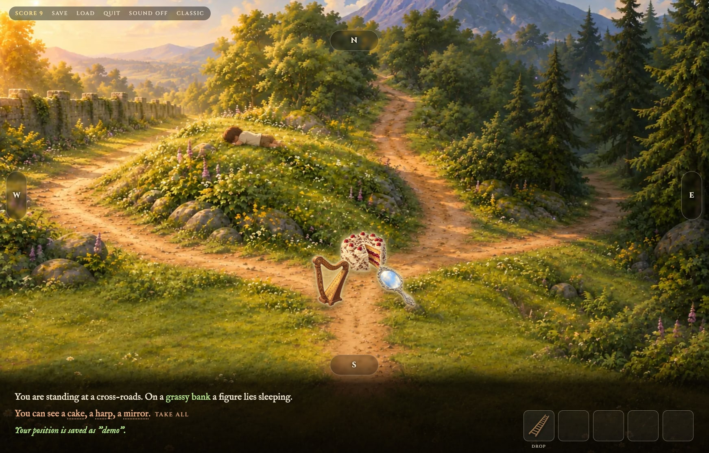
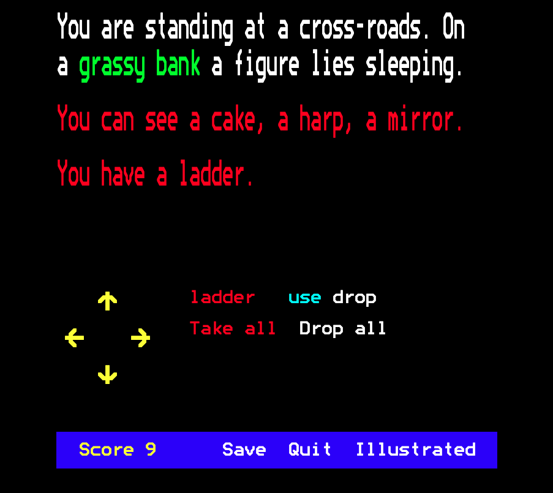

# Merlin's Castle

A remake of **Merlin's Castle**, the adventure game Anita Straker wrote for
the BBC Micro in 1983, now with a painted picture for every place, music, and
sound effects. It plays in your browser, and on phones and iPads you can
install it and play offline.

**Play it at [merlinscastle.net](https://merlinscastle.net/)**



I first remade Merlin's Castle for the web in 2010, and always wanted to give
it pictures. This time it's built straight from the original program: a parser
read the game's DATA statements from the 1983 disk, so every room, object,
message and quirk is exactly as Anita wrote it. Objects are scattered
differently each game, with over 8,000 possible starting layouts, and every one
of them can be won.

You wake up on a grassy bank at a crossroads. Somewhere in this magic land
are objects and treasures; bring as many as you can back to the bank. Click
a way out (or use the arrow keys or N, S, E and W) to move, click objects to
pick them up, and click an object you're carrying (or press 1 to 5) to use
it. You can carry five things at a time.

There are two ways to play:

- **Illustrated**: painted scenes, objects you can see and drag, music and
  sound effects. Use the right object and the picture changes.
- **Classic**: the original 1983 teletext screen, with its font, its colours,
  its beep and its victory tune. Switch between them at any time, even
  mid-game.



It can be played in English or Danish: the game follows
your browser's language, and Language/Sprog switches at any time.

Games can be saved in your browser, and your best score is remembered.
You can also install it on your phone, tablet or computer (Add to Home
Screen, or Install in the browser's menu): it then opens like an app and
downloads the whole world, so it works without a connection.

## Credits

- **Original game**: Anita Straker, 1983, published by ESM. You can still
  play the original at
  [bbcmicro.co.uk](https://bbcmicro.co.uk/game.php?id=2164).
- **Remake**: Drue Wilding, who played it at school and never forgot it,
  built together with Claude (Anthropic).
- **Music**: "The Path of the Goblin King" by Kevin MacLeod
  ([incompetech.com](https://incompetech.com)), licensed under
  [Creative Commons: By Attribution 4.0](https://creativecommons.org/licenses/by/4.0/).
- **Sound effects**: the magical ones (twinkles, harp and bells) were
  composed in code by Claude, in `scripts/make-sounds.js`; the rest are from
  [Kenney](https://kenney.nl) (CC0).
- **Pictures**: painted with ChatGPT from the prompts in `art/prompts`.
- **Trees** (in 3D): Quaternius's
  [Ultimate Nature Pack](https://quaternius.com/packs/ultimatenature.html)
  (CC0), in `art/models/ultimate-nature`.
- **Fonts**: IM Fell English and Cinzel, from Google Fonts.

## Running it locally

You need Node 24.

```sh
npm install
npm run dev        # play at http://localhost:5173
npm test           # run the tests
npm run build      # build the static site into dist/
```

Changes reach `main` through pull requests, checked by
`.github/workflows/code-quality.yml`. Releases are made on purpose: running
**Release please** from the Actions tab opens a release pull request with the
changelog, and merging it publishes the release. Running **Deploy please**
(`.github/workflows/deploy-please.yml`) then builds the latest release and
deploys it to GitHub Pages; give it an older version to roll back.
Dependencies are updated monthly by `.github/workflows/update-please.yml`.

## The 3D version (in the making)

A first-person version you walk through, on the same game engine: see
`PLAN-V3.md`. It's built and deployed with everything else, at `/3d`, but
nothing links to it yet.

```sh
npm run dev                       # walk it at http://localhost:5173/3d
npm run models                    # rebuild the land in Blender (see below)
npm run models -- land --preview  # …and render a picture of it
npm run build && npm run preview  # try the built version at http://localhost:4173/3d
```

Mouse to look, WASD or the arrow keys to walk, Shift to run, Space to jump
(how high is `JUMP_HEIGHT` in `src/three/player.ts`; hold it to keep hopping), Ctrl or C to crouch.
Look at an object and press E to take it; 1 to 5 picks which of your five
slots is in your hand, E (when you're not looking at an object) or a click
uses it and G drops it. (Only some of the objects are in the world so far:
their models are made by `art/blender/items.py`.)
Esc brings back the start screen, where you can save and load: the same
saves as the other versions (a 3D save also knows where you stood and where
everything lies), and Illustrated and Classic carry on the same game there,
as 3D does from them. (While it's being made, 3D is a secret: the other
versions only show their 3D link in a browser that has opened `/3d`.)
With `?debug` (`/3d?debug`, on the dev server as in the build), **0** opens the debug panel: fly (F takes you 35 m
up, and F again drops you back down), walk through anything (N), open every
obstacle (O), show the obstacles and how far they reach, red where they kill
you (R), turn the sky magenta to spot gaps you can see it through (M), float
the places' names over them (L), go faster or slower (. and ,), copy a
picture of what you see to the clipboard (P), and a map to jump anywhere.
The letter keys work with the panel closed, too. Without `?debug`, the
debug panel isn't even loaded, so you see the game as players do.

The land is made in [Blender](https://www.blender.org/) (free), driven by
Python scripts in `art/blender/`: `npm run models` runs each one with no
window and writes its files into `src/three/models/`. Those files are
committed, so you only need Blender to change the land, not to run the game.
Blender is found in `/Applications` on a Mac; elsewhere, set `BLENDER` to its
path.

Everything only the 3D version uses is built into `dist/3d-files/`, which the
service worker leaves out, so players of the game never download it.
`test/land.test.ts` walks the land with every obstacle closed and fails if
you can reach somewhere the original doesn't allow, such as a gap in the
forest.

`npm run gaps` looks for holes you can see the sky through: it opens the
land in a browser with no window (Playwright's WebKit), paints the sky
magenta and looks round from hundreds of spots, along every tunnel, in every
room and round every building. It takes a few minutes and writes
`gaps/index.html`, the worst first, with a picture of each (the gaps in
magenta), and where the ray went through. `npm run gaps -- --near=x,z,r`
checks just round one spot, after a fix, and
`npm run gaps -- --look=x,z,eye,yaw,pitch` takes one picture from anywhere,
to see what's wrong. The first time, `npx playwright install webkit` fetches
the browser.

## How it's made

- `original/`: the tools that recovered the game from the original disk
  image: a disk extractor, a BBC BASIC detokeniser, and `convert.py`, which
  turns the program's DATA statements into `data/world.json`
  (`npm run world`). The disk image itself isn't committed; the
  `.gitignore` says how to fetch it.
- `data/world.json`: the whole game world: 40 rooms, 20 objects and every
  message.
- `data/da.json`: the whole world in Danish, laid over `world.json` by
  `src/engine/localise.ts`. The rest of the Danish is in
  `src/shared/strings.ts`.
- `src/engine/`: the game rules as a pure function,
  `act(world, state, command) → { state, events }`, faithful to the
  original down to its quirks.
- `src/classic/`: the teletext version.
- `src/illustrated/`: the painted version.
- `art/`: the art style guide and a prompt for every picture. `npm run art`
  picks the next picture to paint, copies its prompt to the clipboard and
  shows which reference images to attach. Full-size originals go in
  `art/originals/` (not committed) and are converted into `public/` for the
  game automatically, while `npm run dev` is running or with
  `npm run art:build`. See `art/prompts/README.md`. The pictures that
  change when an object is used (`art/prompts/effects/`) are edits of the
  room's own picture, so only the change moves when they crossfade in.
- `scripts/service-worker.js`: what makes it work offline. The build fills
  in the list of files and writes `dist/sw.js`.
- `src/three/`: the 3D version. `art/blender/layout.json` says where every
  place is, for both the game and Blender; `art/blender/land.py` builds the
  land; `art/blender/studies/` keeps looks to aim for.
- `PLAN.md`: the decisions behind the remake, `PLAN-V2.md` for the pictures
  that change, and `PLAN-V3.md` for the 3D version.

The game's map, text and puzzles are Anita Straker's. The code in this
repository is ISC licensed.
